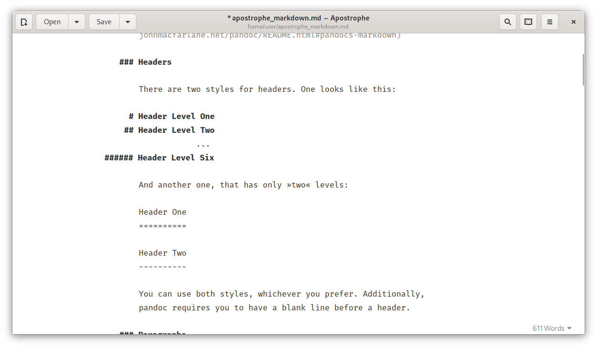

# Postrophe

Postrophe is a **fork and continuation of [Apostrophe](https://gitlab.gnome.org/somas/apostrophe)**,
the distraction-free Markdown editor for GNOME. It is based on Apostrophe 2.4 and is
maintained independently. The original application was created by
[Wolf Vollprecht](https://github.com/wolfvollprecht) and maintained by
[Manuel Genovés](https://gitlab.gnome.org/somas); all credit for the original editor,
its design and its translations belongs to the Apostrophe authors and contributors.

This repository is **not** affiliated with the GNOME project or with the upstream
Apostrophe maintainers. Bug reports about Postrophe-specific changes belong in this
repository, not in Apostrophe's tracker.



## What is different from Apostrophe?

Postrophe keeps the same clean, distraction-free editor and adds:

- **Task lists / checkboxes**
  - `Ctrl+Shift+T` inserts a task item and `Ctrl+Shift+X` toggles the checkbox
    under the cursor or in the selection (also available from the menu).
  - Pressing `Enter` in a task or ordered list continues the list, following the
    GitHub/Typora behaviour. An empty item removes its marker and leaves the list.
  - Checkboxes in the preview are clickable and write the change back into the
    document.
- **Preview performance**
  - Typing no longer reloads the whole preview page: only the document body is
    replaced, so the preview does not flash white anymore and the scroll
    position is preserved.
  - Preview conversion is debounced and unnecessary theme-triggered reloads are
    gone.
- **Stability fixes**
  - Search and replace no longer crashes on invalid regular expressions and no
    longer uses stale selection offsets.
  - Scroll synchronization is more stable while typing.
  - WebKitGTK 4.1 is used when available, with a 4.0 fallback.

## Install

Download the latest `.deb` from the
[Releases](https://github.com/ch0305/Postrophe/releases) page and install it:

```bash
sudo apt install ./postrophe_*.deb
```

The package contains a full copy of the application and therefore replaces a
system-installed `apostrophe` package. Existing Apostrophe settings are copied
to Postrophe's own GSettings schema on first start. To go back:

```bash
sudo apt remove postrophe
sudo apt install apostrophe
```

The package is built for Ubuntu 24.04 and newer. On other distributions, build
from source as described below.

## Building from source

Dependencies on Ubuntu 24.04:

```bash
sudo apt install meson ninja-build sassc gettext \
    libhandy-1-dev libgirepository1.0-dev libgtk-3-dev \
    gir1.2-webkit2-4.1 pandoc python3-gi python3-regex \
    python3-setuptools python3-pypandoc python3-cairo \
    desktop-file-utils libglib2.0-bin
```

Build and run from the source tree (development profile):

```bash
./run-dev.sh
```

Or build it manually:

```bash
meson setup builddir --prefix=/usr -Dprofile=development
ninja -C builddir
./builddir/local-postrophe       # run from the source tree
sudo ninja -C builddir install   # or install system wide
postrophe
```

Use the default Meson profile for a release build (application id
`io.github.ch0305.Postrophe`, no `.Devel` suffix):

```bash
meson setup builddir --prefix=/usr
ninja -C builddir
```

### Building the Debian package

```bash
./make-deb.sh
sudo apt install ./postrophe_*_amd64.deb
```

The script must run with the system Python (`/usr/bin/python3`) and installs its
build into `/usr`. It also unpacks `builddir` into a Debian package and replaces
the old `apostrophe` / `apostrophe-devel` packages by declaring
`Conflicts`/`Replaces`.

### Preview caching

The preview is rendered with `pandoc`. The first preview of a document is a
full page load; subsequent edits only replace the page body, which is what
avoids the flash while typing. Changing the preview theme, the input format or
the window layout still performs a full reload.

## Continuous integration

`.github/workflows/build.yml` builds a `.deb` on every push:

- pushes to `main` build the package and attach it to a rolling
  **Latest build** pre-release;
- tags matching `v*` (for example `v2.5.0`) build the package and publish it as
  a regular GitHub Release.

## Translation

Postrophe inherits Apostrophe's translations. Upstream translation work happens
at [Poeditor](https://poeditor.com/join/project/gxVzFyXb2x); translations for
the strings added by this fork can be sent as pull requests to this repository.

## Credits

- Original Apostrophe: Wolf Vollprecht, Manuel Genovés and contributors.
- Postrophe fork and task-list/preview changes: the Postrophe contributors.

Upstream project: <https://gitlab.gnome.org/somas/apostrophe>

## License

Postrophe is distributed under the GNU General Public License version 3. See
[LICENSE](LICENSE) for details. The original copyright notices are kept in the
source files.
